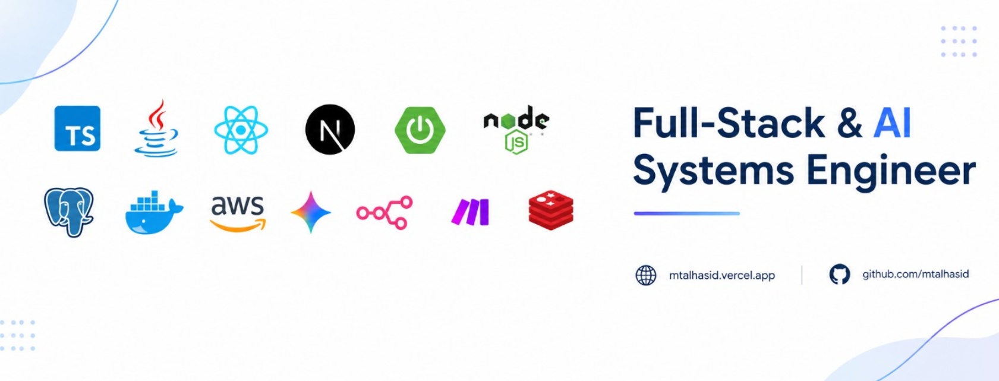

  

 

## About Me
I'm **Talha**, a backend-focused full-stack developer building scalable applications and distributed systems.

<table>
<tr><td><b>Currently Learning</b></td><td>Deepening my knowledge of Spring Boot, Terraform, and distributed systems</td></tr>
<tr><td><b>Open To</b></td><td>Software Engineering Internships, 2027 Graduate Roles, Open-Source Collaboration</td></tr>
</table>

 

## OSS

### [Conductor](https://github.com/conductor-oss/conductor) · 32K+ ⭐
> Workflow orchestration engine by Orkes

- Fixed webhook response validation in Conductor OSS to accept all HTTP 2xx status codes (200–299), rather than only HTTP 200 and 202, resolving [Issue #966](https://github.com/conductor-oss/conductor/issues/966).
- [PR #1157](https://github.com/conductor-oss/conductor/pull/1157) · 

**Tech:** `Java` `Spring Boot`

 

## Featured Projects

### [OU Results](https://github.com/mtalhasid/ou-results-distributed-system) | [results](https://github.com/mtalhasid/ou-results-distributed-system/blob/main/docs/results.md)
> Distributed backend for university result-day traffic spikes. In single-machine k6 tests, sustained 500 req/s at about 10 ms p95 for repeated cached lookups, with 100% request delivery across 50,000+ arrivals; the no-cache baseline degraded at 75 req/s with approximately 19% dropped arrivals.

**Tech:** `Microservices` `Spring Boot` `Spring Cloud Gateway` `Node.js` `Kafka` `RabbitMQ` `Redis` `PostgreSQL` `Docker` `CQRS`

---

### [Emiratiyo Investments](https://emiratiyo.vercel.app)
> An Asset management company helping people diversify their investment portfolios and maximize their returns.

**Tech:** `Spring Boot` `React` `TypeScript` `PostgreSQL` `Docker` `Gemini` `n8n` `Unsplash` `Leaflet.js` `Sanity CMS`

---

### [Vouch Web Copilot](https://vouch-copilot.vercel.app) | [source code](https://github.com/mtalhasid/vouch-copilot)
> Browser-native intelligence platform for any webpage

**Tech:** `Next.js 15` `Node` `Express` `PostgreSQL` `Prisma` `Google Gemini` `Turborepo`

---

### [Axe-Vision](https://axe-vision-platform.vercel.app) | [source code](https://github.com/mtalhasid/axeVision)
> Accessibility compliance platform

**Tech:** `React` `Node.js` `MongoDB` `Redis` `Socket.IO` `Docker` `Turborepo` `Puppeteer` `Google Gemini`

---

### [Pixel UI](https://pixel-ui-web.vercel.app) | [source code](https://github.com/mtalhasid/pixel-ui)
> UI builder with real-time streaming

**Tech:** `Next.js` `TypeScript` `Node.js` `PostgreSQL` `Docker` `Turborepo` `ImageKit AI` `Razorpay`

 

## Freelance Projects
### [The Cheat School](https://thecheatschool.in)
> Full-stack EdTech platform for civil engineering students, delivered within 24 hours of client kickoff.

**Tech:** `React 18` `Vite` `Sanity CMS` `TanStack Query` `Zustand` `Framer Motion` `Tailwind CSS` `shadcn/ui` `Zod`

 

## Tech Stack

### Frontend

### Backend & Languages

### AI & Automation

### Database

### DevOps & Cloud

### Testing & Tools

 

## Achievements

| Event | Result | Project | Scale | Prize |
| :-- | :-- | :-- | :-- | :-- |
| ACES India National Hackathon (Hack Revolution 2025) | 1st Place | FlowCare | 400+ teams | ₹35,000 |
| National Hackathon (Hack Forge 2025) | 1st Place | Health Tracker | 280+ teams | ₹20,000 |
| International Hackathon (Feuji AI 2025, hosted by T-Hub) | 3rd Place | WebLenses | 7,000+ teams | ₹50,000 |
| MJCET College Magazine (2024–25) | Recognized for highest technical achievements | — | 360+ students | — |

 
